<h1 align="center">ResearchPaL</h1>
<p align="center"><strong>Multi-Agent Academic RAG Assistant with Layout-Aware Parsing</strong></p>

<p align="center">
  
  
  
  
  
  
</p>

<p align="center">
ResearchPaL is a multi-agent academic research assistant that enables question answering over scientific papers while preserving document structure, figures, tables, equations, and page-level citations.
Unlike conventional RAG systems that treat PDFs as plain text, ResearchPaL uses layout-aware document parsing, hybrid retrieval, reranking, and grounded citation verification to improve retrieval quality on complex research papers. The system supports both single-paper exploration and cross-paper literature review through a stateful LangGraph workflow.

</p>

---
<p>
  <h2>Why ResearchPaL?</h2>

Most academic RAG systems rely on plain-text extraction, causing figures, tables, equations, and document structure to be lost during indexing. This often leads to incomplete retrieval and hallucinated answers.

ResearchPaL addresses these limitations by combining:

* Layout-aware parsing for structured PDF understanding
* Hybrid retrieval using dense vectors and keyword search (RRF)
* Cross-encoder reranking to improve retrieval precision
* Multi-agent orchestration with LangGraph
* Grounded responses with page-level citation verification
* Multi-document retrieval for comparative literature review

The result is a system designed specifically for interacting with complex scientific documents rather than generic text.

</p>


## Interface

<table>
  <tr>
    <td align="center"><strong>Paper Discovery & ArXiv Search</strong></td>
    <td align="center"><strong>API Key Configuration</strong></td>
  </tr>
  <tr>
    <td>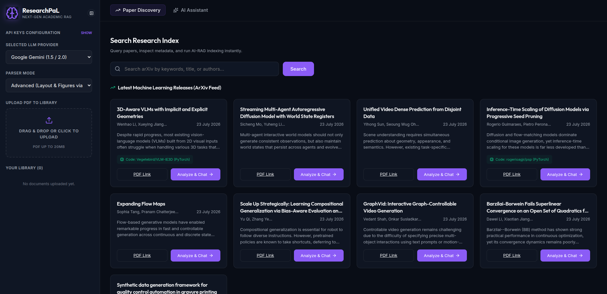</td>
    <td>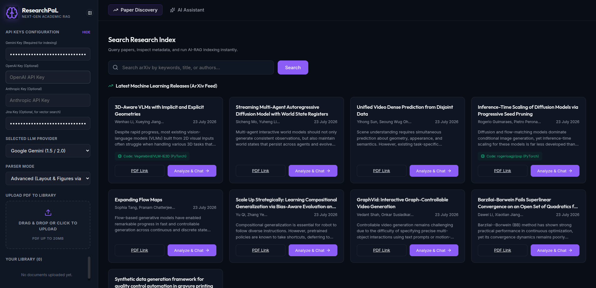</td>
  </tr>
  <tr>
    <td align="center"><strong>Chat with Sources & Citations</strong></td>
    <td align="center"><strong>Collapsed Workspace Panels</strong></td>
  </tr>
  <tr>
    <td>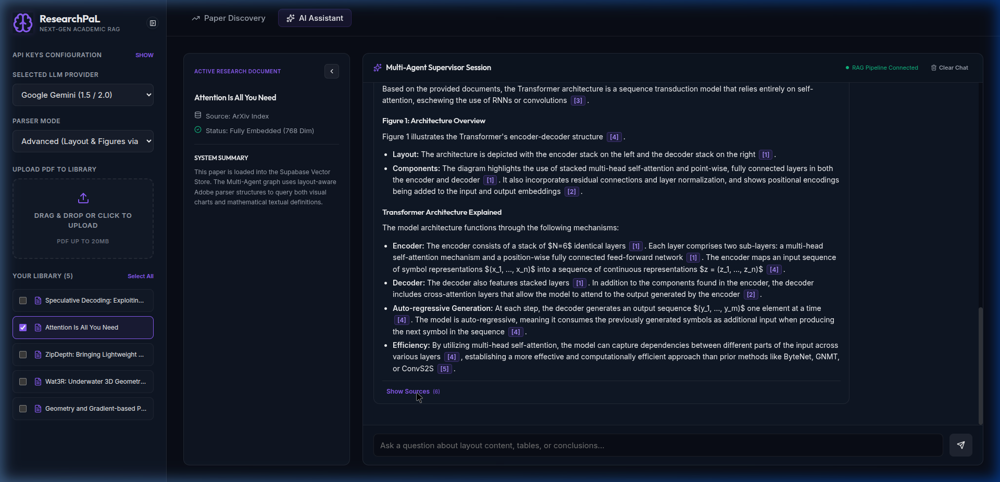</td>
    <td>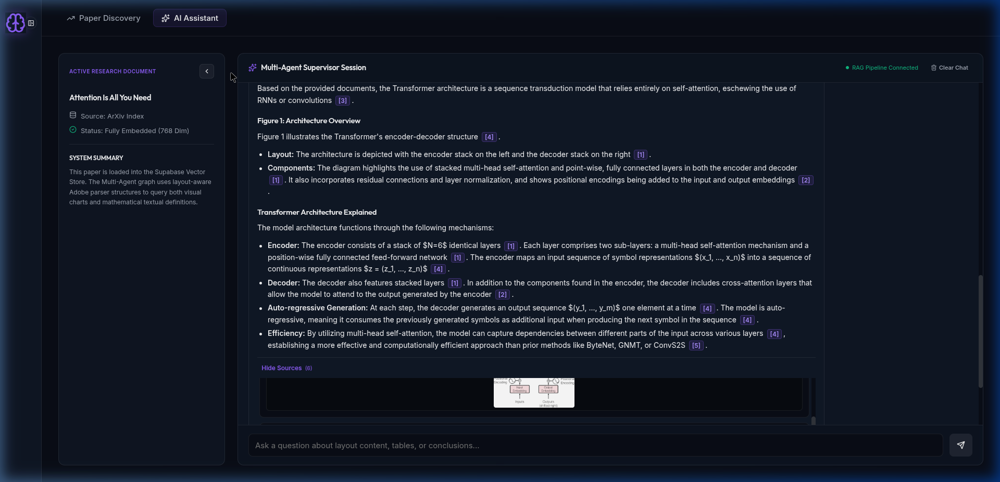</td>
  </tr>
</table>

### Feature Demos

| Workspace Minimization & Lightbox Zoom | Multi-Page Citations & Dynamic Figures |
|:---:|:---:|
| 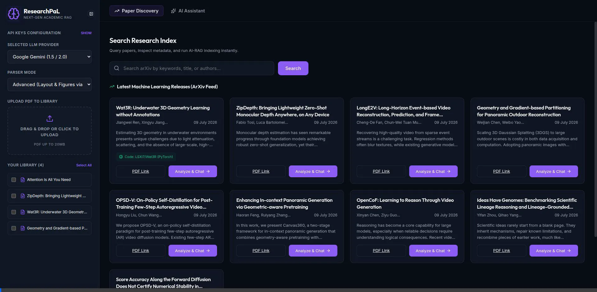 |  |

---

## System Architecture

<!-- PLACEHOLDER: Replace with your own architecture diagram -->
<!-- Prompt for generating architecture diagram:
"Create a system architecture diagram for an academic RAG application with these components:
LEFT: React Frontend (Dark theme UI) with Paper Discovery Tab, AI Chat Tab, Library Sidebar
CENTER: FastAPI Backend with endpoints: /api/parse, /api/parse_url, /api/chat (streaming), /api/papers/trending, /api/figures/download
RIGHT TOP: LangGraph Multi-Agent Pipeline with 4 nodes in sequence: Intent Router → Hybrid Retriever → Jina Reranker → Response Generator
RIGHT BOTTOM: Supabase (PostgreSQL + pgvector + Storage Buckets)
BOTTOM: PDF Parsing Pipeline: PyMuPDF (basic mode) and Adobe PDF Services API (advanced mode) feeding into Semantic Chunking then Jina/Gemini Embeddings (768-dim)
Use dark background (#0f172a), purple accents (#8b5cf6), green status indicators (#10b981), clean arrows showing data flow. Modern flat design."
-->

<p align="center">
  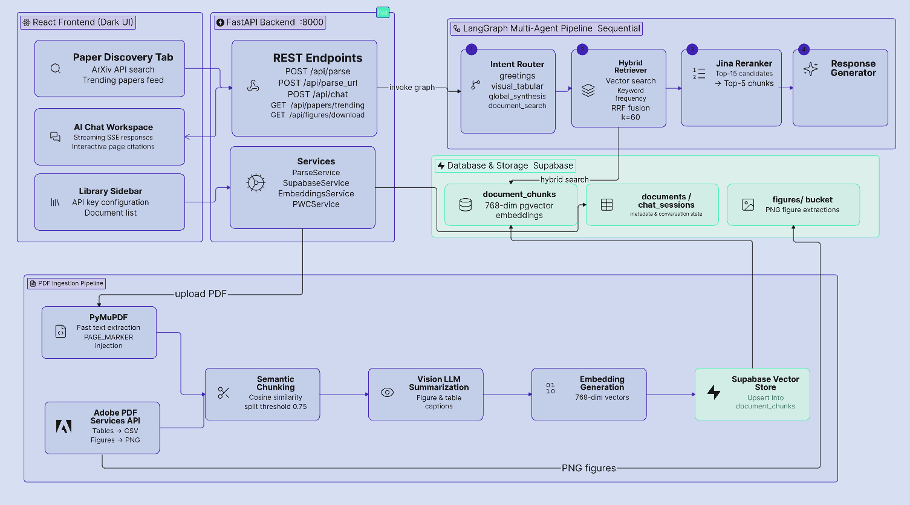
</p>

---

## System Capabilities

### Multi-Modal (Layout-Aware) Document Ingestion
ResearchPaL supports two ingestion pipelines depending on the required level of document understanding.
| Mode         | Parser                 | Purpose                                  | Speed    |
| --------------| ------------------------| ----------------------------------------| ----------|
| **Basic**    | PyMuPDF                | Fast text extraction using PyMuPDF with page boundary preservation | Fast     |
| **Advanced** | Adobe PDF Services API | Extracts structured text, tables, and figures using Adobe PDF Services before semantic indexing   | Thorough |

Advanced mode preserves visual information that is typically lost in conventional PDF-based RAG pipelines

### Multi-Agent LangGraph Pipeline

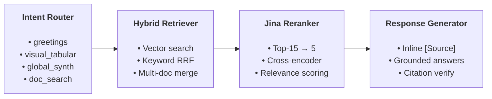
Each stage is isolated to improve modularity, debuggability, and retrieval quality.

### Hybrid Search with Reciprocal Rank Fusion
Combines dense vector similarity (Jina/Gemini embeddings) with keyword frequency matching, merged via Reciprocal Rank Fusion(RRF):

$$\text{Score}(d) = \frac{1}{60 + \text{Rank}_{\text{vector}}} + \frac{1}{60 + \text{Rank}_{\text{keyword}}}$$

This reduces failures caused by terminology mismatch while preserving semantic understanding for natural language questions.

### Interactive Chat UX
- **Clickable Citations**: `[Source 1]` badges scroll to and highlight the exact source card
- **Collapsible Source Cards**: Expand to view text chunks, tables, or figures with page numbers
- **Lightbox Zoom**: Click any retrieved figure to inspect at full resolution
- **Hallucination Guard**: Citation indices exceeding source count are downgraded to plain text

### Multi-PDF Literature Review
Select multiple papers from the library sidebar and run cross-document comparative queries. The pipeline performs unified hybrid search across all selected documents.

### Grounded Responses
Every generated answer is linked back to retrieved evidence through page-level citations. Invalid citations are automatically removed before rendering to reduce hallucinated references.

### Provider Flexibility
| Component | Options |
|-----------|---------|
| **Chat LLM** | Google Gemini · OpenAI GPT-4o-mini · Anthropic Claude 3.5 |
| **Embeddings** | Jina AI v3 (768-dim) · Google Gemini Embedding · OpenAI |
| **Reranker** | Jina Reranker v2 (optional, auto-detected) |
| **Vision** | Gemini Flash Lite → Groq Llama 3.2 Vision (auto-fallback) |

### Resilience & Fallbacks
- **Rate Limit Recovery**: Gemini 429 errors auto-fallback to Groq models during ingestion
- **ArXiv URL Rewriting**: Abstract URLs (`arxiv.org/abs/`) auto-converted to PDF links
- **Magic Byte Validation**: Downloaded PDFs verified via `%PDF` header signature
- **Client-Side Key Storage**: API keys stored in `localStorage`, never sent to servers

---

## Design Decisions

Why LangGraph?

The retrieval workflow requires conditional routing, shared state, retries, and multiple specialised agents. LangGraph provides explicit control over execution flow while remaining easier to debug than prompt-only orchestration.


Why Hybrid Retrieval?

Dense retrieval performs well for semantic similarity but can miss exact terminology, equations, or abbreviations commonly found in research papers. Combining dense retrieval with keyword search using Reciprocal Rank Fusion significantly improves retrieval robustness.


Why Jina Reranker?

Initial retrieval favours recall over precision. The reranker refines candidate passages before generation, improving relevance for figure, table, and long-context queries.


Why Layout-Aware Parsing?

Academic PDFs contain structured information that is often discarded during plain-text extraction. Preserving tables, figures, and page boundaries allows ResearchPaL to generate answers grounded in the original document rather than reconstructed text alone.


Why PostgreSQL + pgvector?

Using pgvector allows vector search and relational metadata to coexist in the same database, simplifying deployment while supporting hybrid retrieval without introducing an additional vector database.

---

## Evaluation Results

The retrieval pipeline was benchmarked on a **custom academic dataset** of 4 research papers with 10 questions each, evaluating across multiple chunk sizes (1000–2500) and retrieval depths (k=3–25). Full evaluation data and scripts are in the [`evals/`](evals/) directory.

### Metrics Overview

| Metric | Best Score | Configuration |
|--------|-----------|---------------|
| **F1 Score** (CP × CR harmonic mean) | **0.556** | Chunk=2500, k=7 |
| **Context Recall** | **0.927** | Chunk=2500, k=13 |
| **Context Precision** | **0.374** | Chunk=2500, k=13 |
| **MRR** (Mean Reciprocal Rank) | **0.757** | Chunk=2500 |
| **NDCG** | **0.765** | Chunk=2500 |
| **Hit@5** | **1.000** | Chunk=2500 |
| **Figure@1 Hit-Rate** | **1.000** | k≥13 |
| **Table@1 Hit-Rate** | **1.000** | k≥13 |
| **P50 Query Latency** (text-only) | **646 ms** | Default mode |
| **P50 Response Latency** (text-only) | **2,620 ms** | Default mode |

| Configuration          | Context Precision | Context Recall | Notes                           |
| ---------------------- | ----------------: | -------------: | ------------------------------- |
| **Hybrid Retrieval**       |             0.374 |          0.927 | Best retrieval without reranker |
| **Hybrid + Jina Reranker** |         **0.390** |      **0.927** | **+4.2% precision improvement**  |


### 1. Context Precision & Context Recall (Default Mode)

<p align="center">
  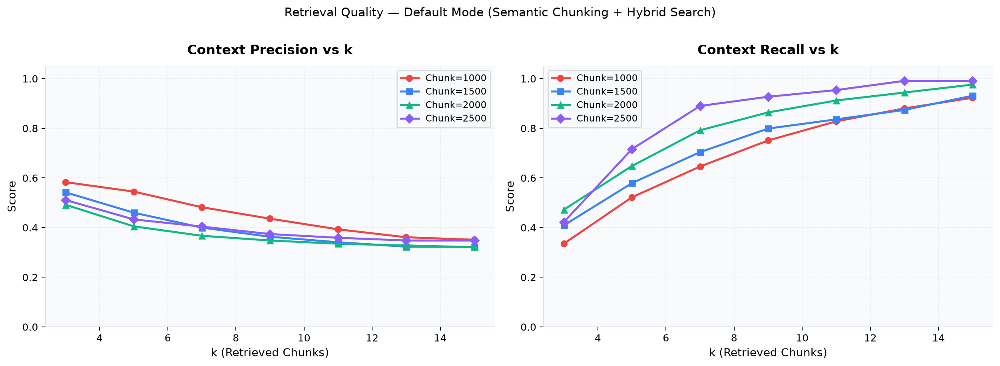
</p>

**Optimal Configuration**: With a Context Recall threshold of 0.90, `chunk_size=2500` and `k=9` provides the best precision-recall trade-off (CR=0.927, CP=0.374, F1=0.556).

### 2. F1 Score (Default Mode)

<p align="center">
  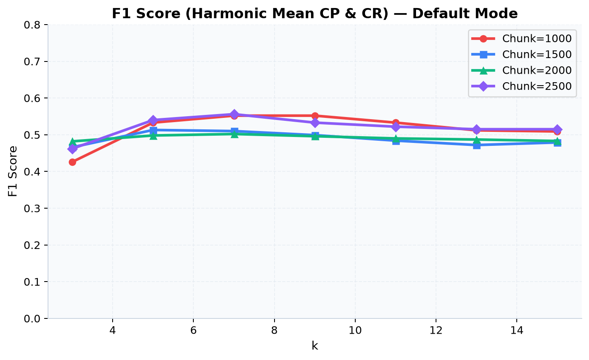
</p>

### 3. MRR & NDCG (Default Mode)

<p align="center">
  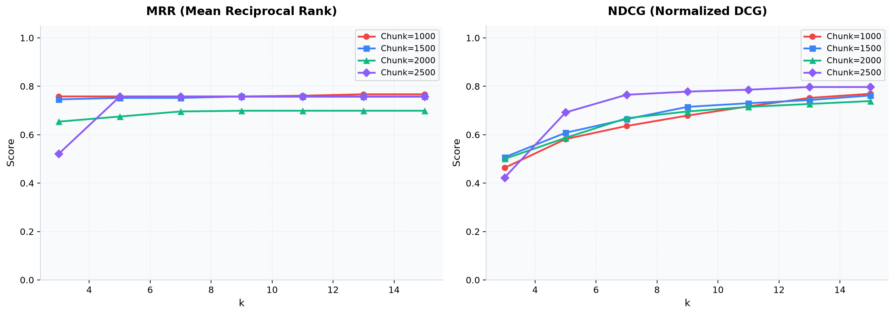
</p>

MRR of **0.757** indicates the first relevant chunk typically appears in the top 1–2 positions. NDCG of **0.765** confirms strong ranking quality across all retrieved positions.

### 4. Hit@K Rates (Default Mode)

<p align="center">
  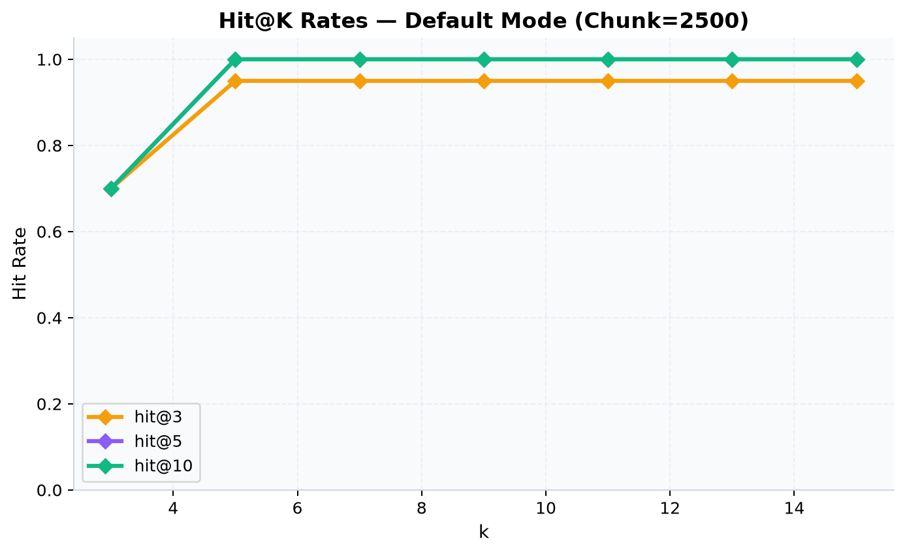
</p>

**Hit@5 = 1.0**: Every query finds at least one relevant chunk within the top 5 results.

### 5. Advanced Mode (Layout-Aware Parsing)

<p align="center">
  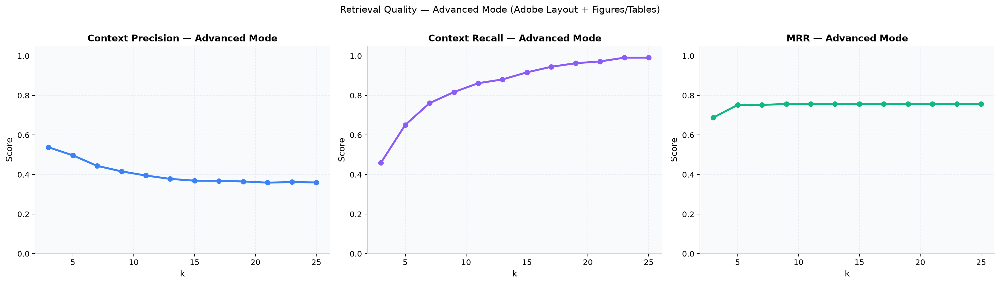
</p>

Advanced mode uses the same text chunks as Default but adds structured figure and table extractions from the Adobe PDF Services API.

### 6. Figure@1 & Table@1 Hit-Rate

<p align="center">
  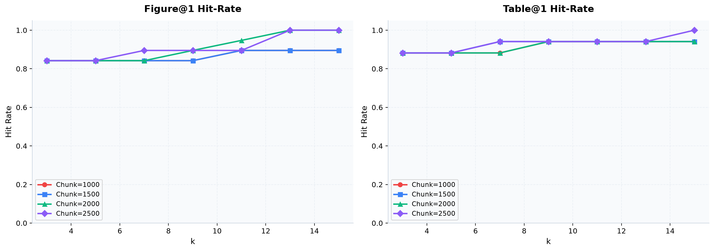
</p>

Both metrics reach **1.0** at k≥13, meaning every figure/table-specific query successfully retrieves the correct visual asset.

### 7. Reranker Effectiveness

<p align="center">
  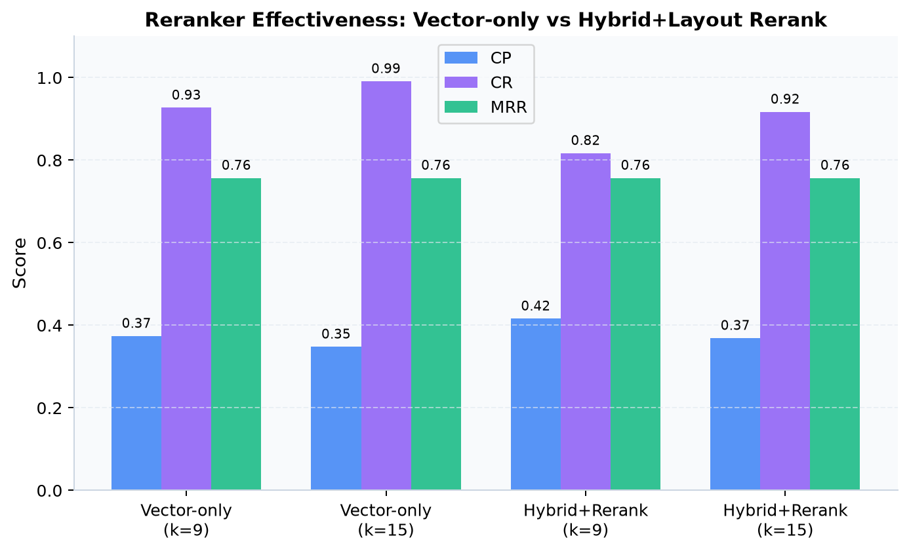
</p>

Layout-aware reranking (Advanced mode) improves Context Precision by **+4.2%** at k=9 by boosting figure/table chunks for visual queries while maintaining high MRR.

### 8. Latency Breakdown (P50)

<p align="center">
  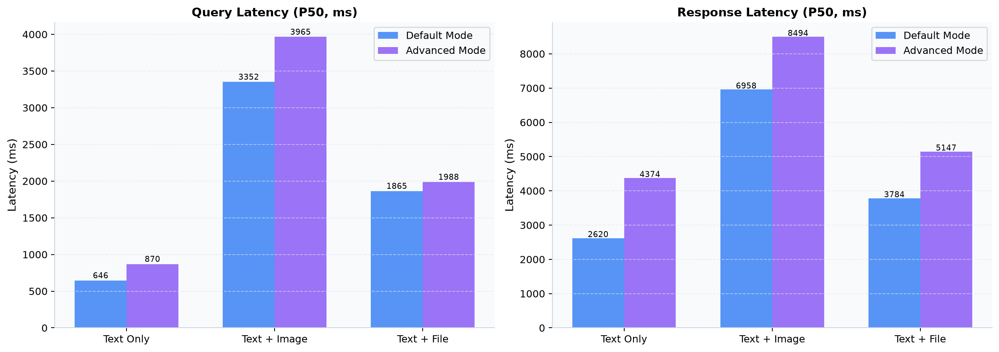
</p>

| Query Type | Query Latency (Default) | Query Latency (Advanced) | Response Latency (Default) | Response Latency (Advanced) |
|:---:|:---:|:---:|:---:|:---:|
| **Text Only** | 646 ms | 870 ms | 2,620 ms | 4,374 ms |
| **Text + Image** | 3,352 ms | 3,965 ms | 6,958 ms | 8,494 ms |
| **Text + File** | 1,865 ms | 1,988 ms | 3,784 ms | 5,147 ms |

> **Note**: Latencies measured with Gemini models (free tier). Text-only queries achieve sub-second retrieval and sub-3s response generation.

---

## Ingestion Pipeline

<!-- PLACEHOLDER: Replace with your own pipeline diagram -->
<!-- Prompt for generating pipeline diagram:
"Create a data flow diagram for a PDF ingestion pipeline:
START: 'Upload PDF' → Decision: 'Choose Parser Mode'
  Branch 1 (Basic): 'PyMuPDF Text Extraction' → injects [PAGE_MARKER_N] tokens
  Branch 2 (Advanced): 'Adobe PDF Services API' → outputs 'Table CSVs' + 'Figure PNGs'
Both branches merge into: 'Semantic Chunking' (embedding-similarity sentence grouping, cosine threshold 0.75)
→ 'Vision LLM Summarization' (figures described by Gemini Flash Lite / Groq fallback)
→ 'Jina AI / Gemini Embeddings' (768-dimension vectors)
→ 'Supabase pgvector Store' (document_chunks table)
Use dark background, purple/green accent colors, clean rounded boxes."
-->

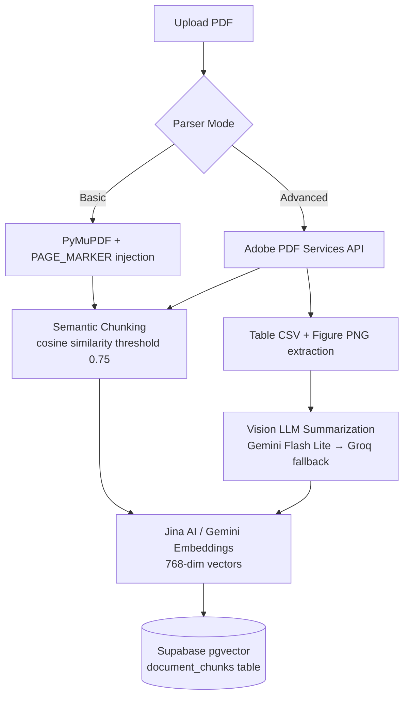

---

## 🛠️ Installation & Setup

### Prerequisites
- Python 3.10+
- Node.js v16+
- Supabase account (Database + Storage Bucket)
- API Keys: Google Gemini (required), Jina AI (recommended), Adobe PDF Services (optional for advanced mode)

### 1. Database Setup

Run the SQL in [`server_side/backend/schema.sql`](server_side/backend/schema.sql) in your Supabase SQL editor. This creates:
- `documents` table (paper metadata)
- `document_chunks` table (text/figure/table embeddings with `vector(768)`)
- `chat_sessions` and `chat_messages` tables (conversation persistence)
- `match_chunks_v2` function (multi-document vector similarity search)

### 2. Backend

```bash
cd server_side/backend
python3 -m venv .venv
source .venv/bin/activate
pip install -r requirements.txt
```

Create `.env`:
```env
SUPABASE_URL=https://your-project.supabase.co
SUPABASE_KEY=your-service-role-key
GEMINI_API_KEY=your-gemini-key
JINA_API_KEY=your-jina-key          # Optional but recommended
PDF_SERVICES_CLIENT_ID=your-adobe-id     # Optional (advanced parser)
PDF_SERVICES_CLIENT_SECRET=your-secret   # Optional (advanced parser)
```

Start the server:
```bash
uvicorn main:app --host 0.0.0.0 --port 8000
```

### 3. Frontend

```bash
cd server_side/frontend
npm install
npm run dev
```

Configure `API_BASE` in `src/App.jsx` to point to your backend (default: `http://localhost:8000`).

---

## Project Structure

```
ResearchPaL/
├── server_side/
│   ├── backend/
│   │   ├── main.py                    # FastAPI endpoints & background tasks
│   │   ├── graph/
│   │   │   └── agent.py               # LangGraph multi-agent state machine
│   │   ├── services/
│   │   │   ├── supabase_service.py    # DB ops, hybrid search, RRF
│   │   │   ├── embeddings_service.py  # Jina / Gemini / OpenAI embeddings
│   │   │   ├── parse_service.py       # PyMuPDF + Adobe PDF parser
│   │   │   └── pwc_service.py         # ArXiv API search & trending
│   │   ├── schema.sql                 # Supabase table definitions
│   │   └── requirements.txt
│   └── frontend/
│       ├── src/
│       │   ├── App.jsx                # Main React SPA component
│       │   ├── App.css                # Dark-mode design system
│       │   └── index.css              # CSS variables & animations
│       └── package.json
├── evals/
│   ├── compute_all_metrics.py         # Computes CP, CR, F1, MRR, NDCG, Hit@K
│   ├── generate_plots.py              # Generates all 8 evaluation plots
│   ├── data/                          # Ground truth Q&A per paper
│   ├── results/                       # Computed metric JSONs
│   └── plots/                         # Generated PNG charts
├── artifacts/                         # Development docs & screenshots
└── README.md
```

---

## Security

- **API keys are never stored on any server** — they live exclusively in `localStorage` and are sent via request headers
- **Supabase RLS** can be configured for row-level access control
- **CORS** is configured to restrict origins to known frontend URLs

---

## Limitations & Future Work

| Current Limitation | Planned Improvement |
|---|---|
| No code repository integration | PapersWithCode API for linked GitHub repos |
| Groq models have limited context windows | Hybrid context compression with long-context models |
| Single-page citation linking | Split-screen PDF viewer with bounding-box highlights |
| No offline/local model support | Ollama integration for fully offline RAG |
| No export functionality | Research Notes pad with Markdown/PDF export |

---

## License

This project is licensed under the MIT License.

---


